# AsterTI

## Gestão de ativos de tecnologia da informação

O **AsterTI** é uma aplicação web voltada ao controle operacional de ativos de
TI. O sistema reúne inventário, chamados técnicos, movimentações, remessas,
controle de material de consumo pelo Aster Estoque, estrutura organizacional,
usuários, permissões, documentos formais, exportações e auditoria em uma
experiência única.

Este repositório é uma apresentação pública de portfólio. Ele contém somente
documentação e capturas produzidas com dados fictícios. **O código-fonte do
AsterTI é privado, proprietário e não integra este repositório.**

## Visão rápida

| Indicador | Escala confirmada |
|---|---|
| Áreas funcionais documentadas | 14 |
| Perfis de acesso | 5 |
| Materiais visuais revisados | 23 capturas de tela |
| Versão pública documentada | 2.02 (16 de outubro de 2026) |
| Camadas de testes automatizados | Backend e fluxos de interface |
| Rastreabilidade | Histórico de ações, linha do tempo por ativo e auditoria por contexto |

## Problema que o sistema resolve

Controles de equipamentos distribuídos entre planilhas, documentos e registros
manuais dificultam localizar um ativo, identificar seu responsável, acompanhar
uma manutenção e reconstruir seu histórico. O AsterTI centraliza essas
informações e aplica regras operacionais ao ciclo de vida do ativo, oferecendo
rastreabilidade e visibilidade gerencial.

## Tour visual

As capturas abaixo percorrem o sistema na ordem em que um ativo é usado no dia
a dia: do acesso ao cadastro, da operação ao controle de estoque, da gestão à
auditoria. Todas foram produzidas em ambiente descartável, com dados fictícios.

### Acesso e visão geral

| | |
|---|---|
| 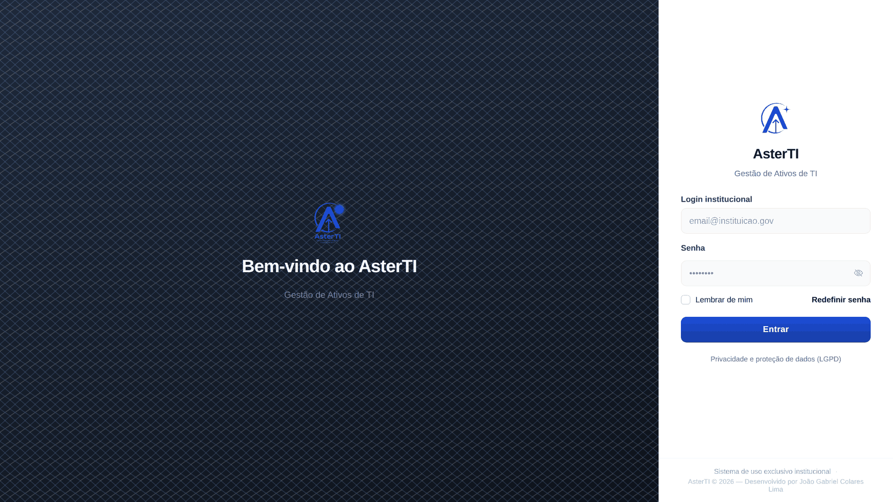 |  |
| **Acesso** — autenticação institucional e aviso de privacidade (LGPD). | **Dashboard** — indicadores, distribuição do inventário, análise de chamados por tempo sem atualização e atalhos da Central Operacional. |

### Inventário e ciclo de vida do ativo

**Inventário** — indicadores por estado operacional (em uso, manutenção, com
defeito, reserva, desativados), abas por procedência (adquirido, cedido,
alugado, externo), localização por local e setor, responsável ou uso
corporativo e carimbo da última alteração com o autor.

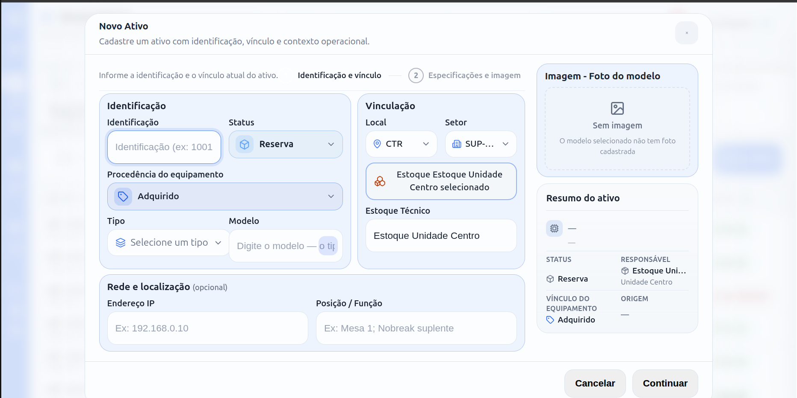

**Novo ativo** — cadastro em duas etapas (identificação e vínculo;
especificações e imagem), com resumo do ativo em tempo real e destino de
estoque técnico.

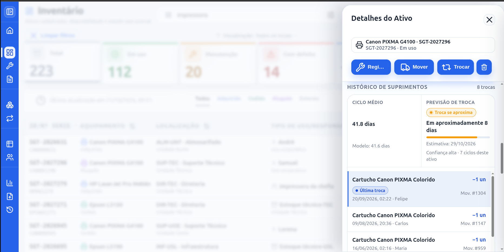

**Histórico de suprimentos** — trocas de toner e cartucho por impressora, com
ciclo médio e **previsão da próxima troca**, calculada a partir do uso real.

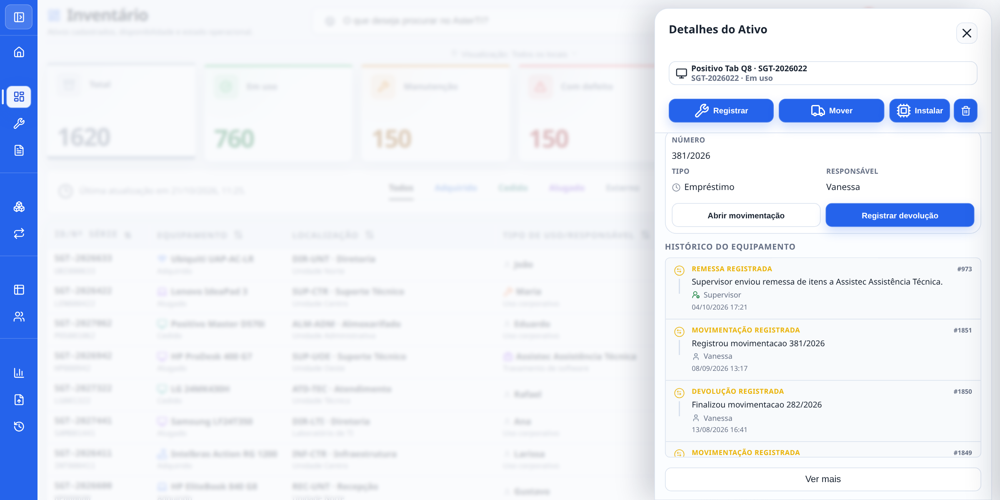

**Ficha do ativo** — movimentação atual, devolução em um clique e linha do
tempo de tudo o que já aconteceu com o equipamento (remessas, empréstimos,
devoluções, manutenções).

### Suporte Técnico

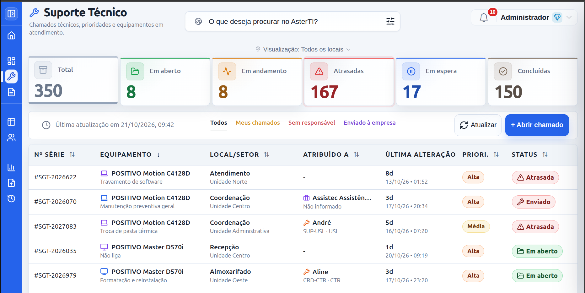

**Suporte Técnico** — chamados por situação (em aberto, em andamento,
atrasados, em espera, concluídos), prioridade, responsável e visões rápidas
(meus chamados, sem responsável, enviados à empresa).

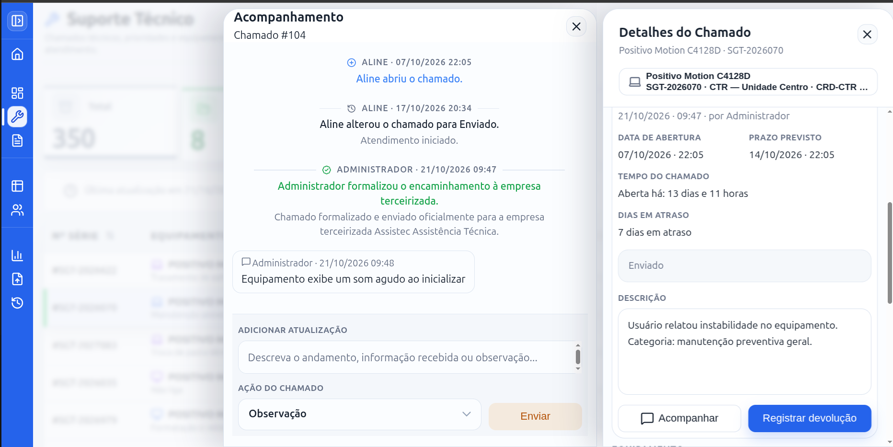

**Acompanhamento** — ficha de consulta do chamado e linha de atualizações,
incluindo o encaminhamento formalizado a uma empresa contratada.

### Movimentações e rastreamento

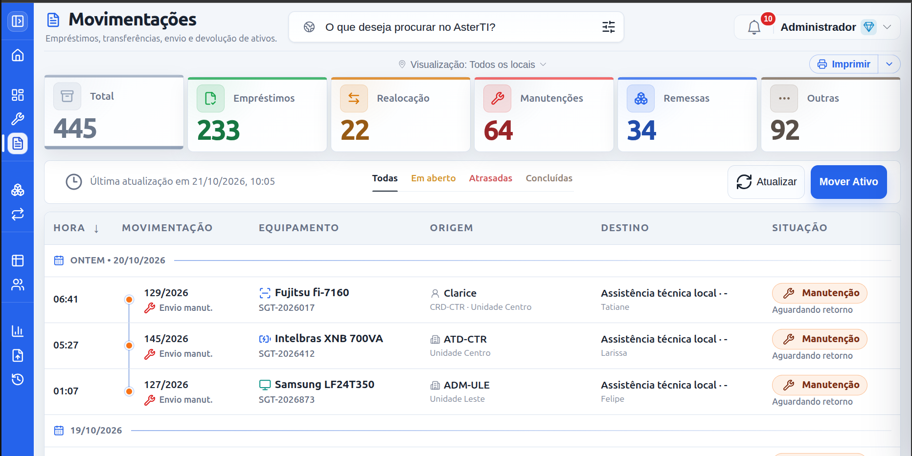

**Movimentações** — empréstimos, realocações, manutenções, remessas e outras
operações, com origem, destino, responsável, situação e documento associado.

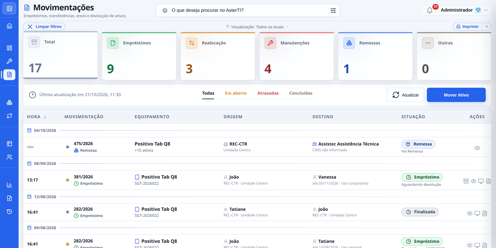

**Rastreamento de um ativo** — a busca por um equipamento reconstrói todo o seu
percurso: entrada, empréstimos, cedências, idas e voltas da manutenção em
empresa parceira e realocações entre setores e unidades.

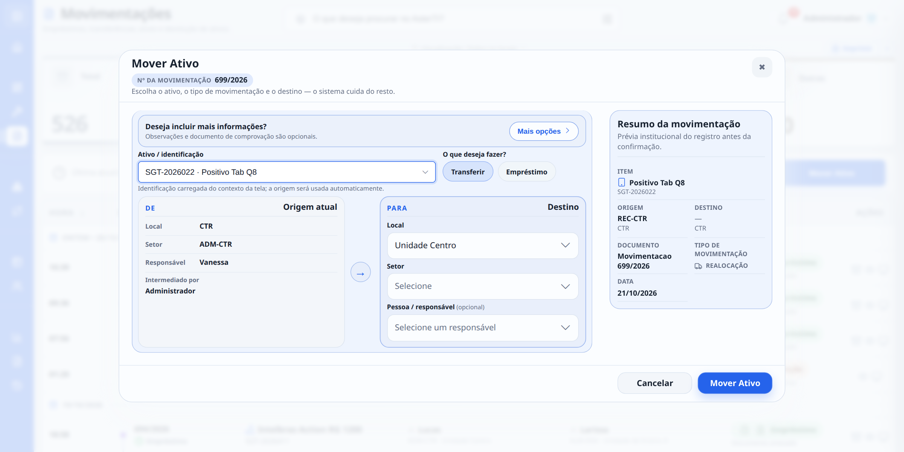

**Mover ativo** — fluxo em tela única: o sistema preenche a origem, o usuário
escolhe o tipo (transferir ou emprestar) e o destino, e o resumo prévio mostra
exatamente o que será registrado, com a numeração do documento.

### Aster Estoque

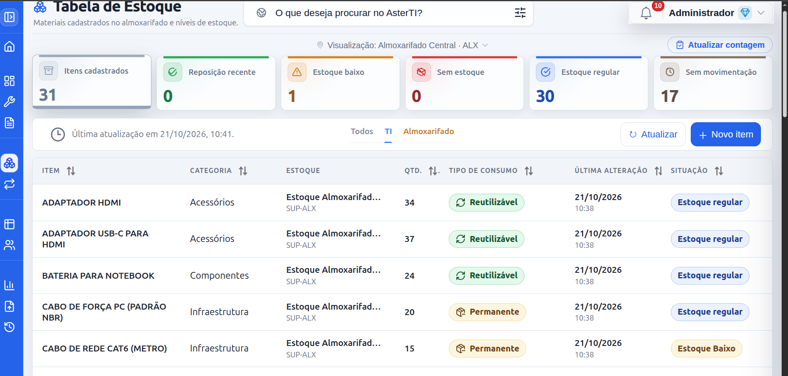

**Tabela de estoque** — materiais por almoxarifado ou estoque técnico, com
alertas de reposição, saldo baixo, itens sem movimentação e natureza
operacional do item (reutilizável, consumo permanente ou cíclico).

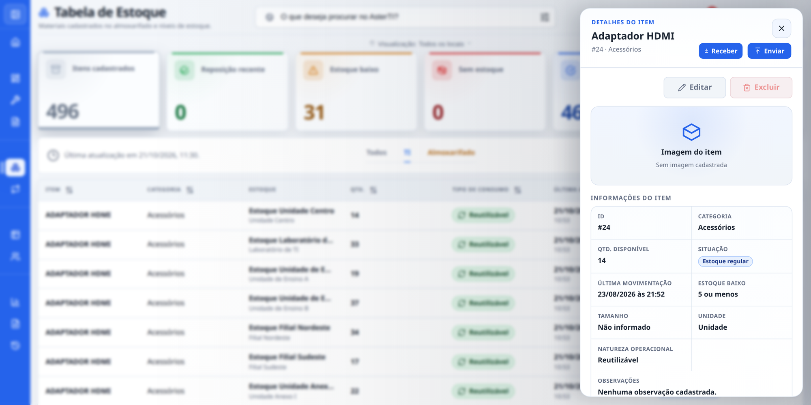

**Item de estoque** — saldo, situação, última movimentação, unidade, natureza
operacional e atalhos para receber, enviar, editar ou excluir.

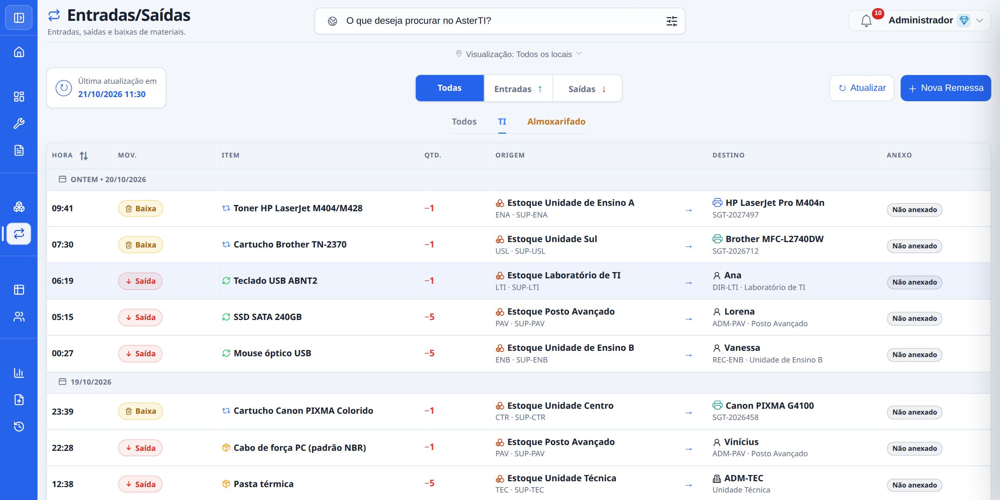

**Entradas e saídas** — todas as movimentações de material, com origem,
destino (pessoa, setor e unidade, ou o equipamento que recebeu o suprimento),
badges de entrada, saída e baixa, e anexos.

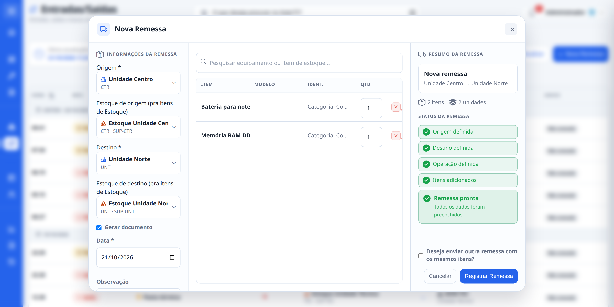

**Remessa** — envio ou recebimento de um lote de ativos e material entre
unidades numa única operação, com origem, destino, estoque de destino,
documento próprio e confirmação de que a remessa está pronta.

### Gestão

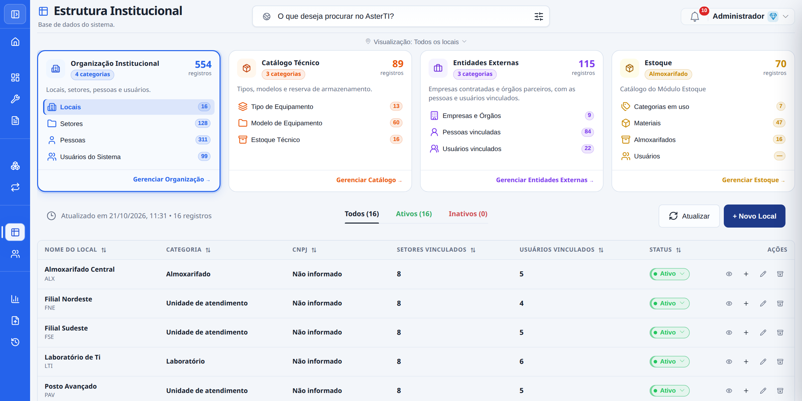

**Estrutura Institucional** — a base de cadastros do sistema, em quatro áreas:
Organização Institucional (locais, setores, pessoas e usuários), Catálogo
Técnico (tipos, modelos e estoque técnico), Entidades Externas (empresas
contratadas e órgãos parceiros) e Estoque.

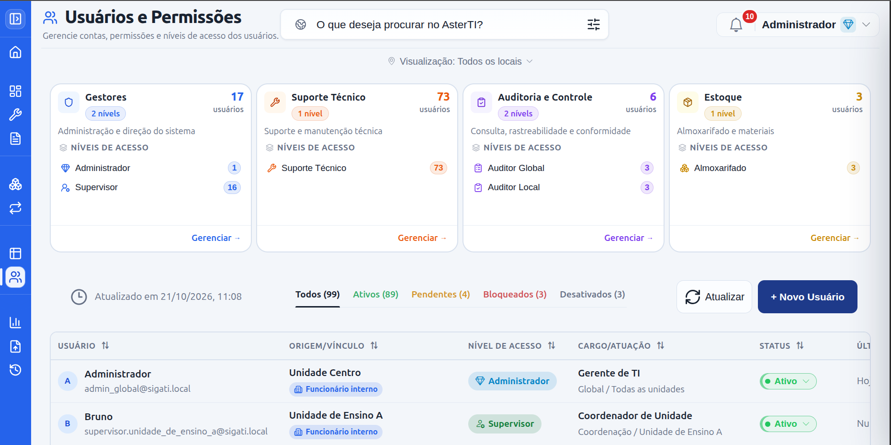

**Usuários e Permissões** — contas agrupadas por área de responsabilidade e
nível de acesso, com situação (ativos, pendentes, bloqueados, desativados),
origem, vínculo e último acesso.

### Auditoria e inteligência operacional

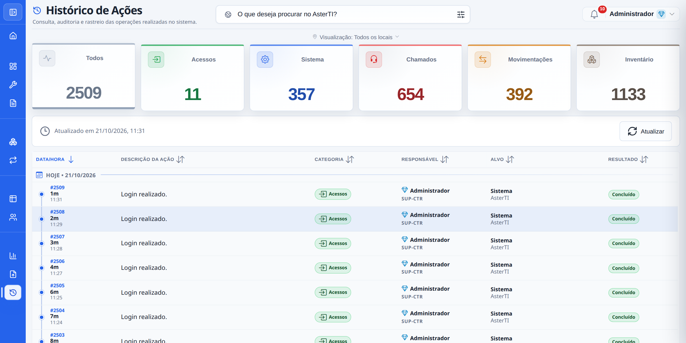

**Histórico de Ações** — trilha de auditoria em linguagem operacional, por
categoria (acessos, sistema, chamados, movimentações, inventário), com
responsável, alvo e resultado de cada ação.

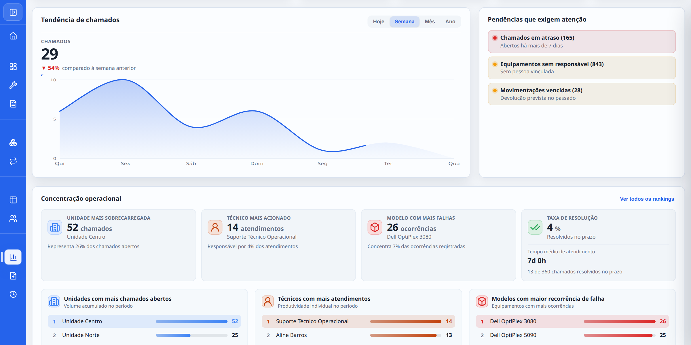

**Análise Operacional** — tendência de chamados por período, pendências que
exigem atenção e concentração operacional: unidade mais sobrecarregada,
técnico mais acionado, modelo com mais falhas e taxa de resolução.

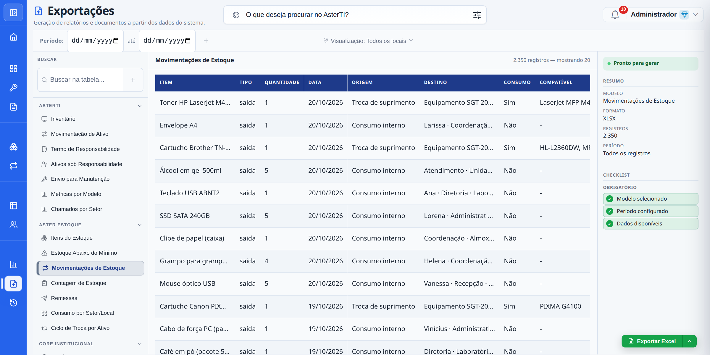

**Exportações** — central de relatórios e documentos formais, com
pré-visualização, período, escopo conforme o perfil e geração em Excel ou PDF.

### Experiência de uso

| | |
|---|---|
| 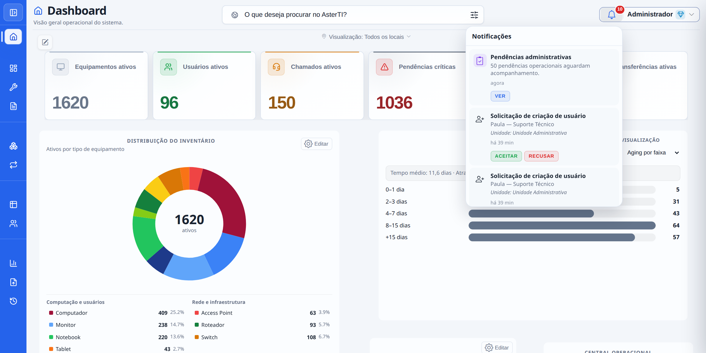 | 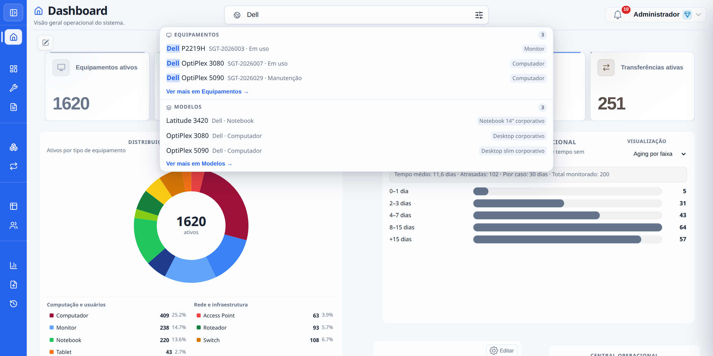 |
| **Notificações** — pendências administrativas e solicitações de criação de usuário, com aceite ou recusa na própria lista. | **Busca global** — equipamentos e modelos encontrados de qualquer tela, com destaque do termo. |

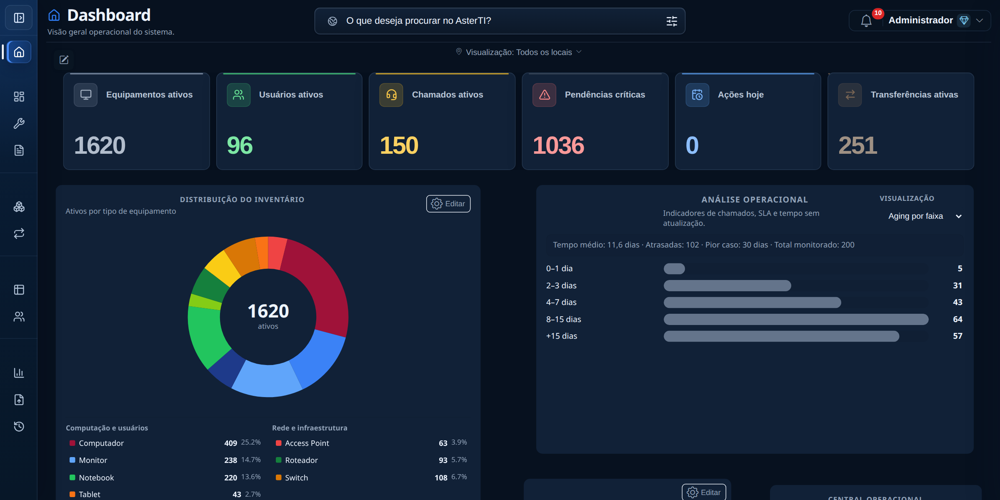

**Tema escuro** — o mesmo sistema em paleta escura, preferência salva por
usuário.

Mais informações em [Screenshots](screenshots/README.md).

## Principais módulos

| Módulo | Finalidade |
|---|---|
| Dashboard | Indicadores consolidados, distribuição do inventário e Central Operacional personalizável. |
| Inventário | Cadastro e consulta de equipamentos, procedência, situação, localização e responsabilidade. |
| Suporte Técnico | Registro e acompanhamento de chamados, prioridades, responsáveis, conclusão e envio a empresas contratadas. |
| Movimentações | Empréstimos, transferências, manutenção externa, devoluções e posse, com rastreamento do ciclo completo do ativo. |
| Remessas | Envio e recebimento de lotes entre unidades, com numeração e documento próprios. |
| Aster Estoque | Controle de material de consumo e de componentes por almoxarifado e estoque técnico, com contagem, alertas e previsão de troca de suprimento. |
| Documentos formais | Movimentação de ativo, termo de responsabilidade, envio para manutenção, ativos sob responsabilidade, contagem de estoque e remessa, com numeração única. |
| Estrutura Institucional | Locais, setores, pessoas, tipos, modelos, estoque técnico e entidades externas. |
| Custódia | Responsável por pessoa, setor ou box/guichê, inclusive em atendimento. |
| Usuários e Permissões | Administração de contas, perfis e escopos de acesso. |
| Histórico de Ações | Auditoria de eventos relevantes em linguagem operacional, geral ou por contexto. |
| Análise Operacional | Indicadores, tendências, rankings e alertas de acompanhamento. |
| Exportações | Geração controlada de relatórios e documentos autorizados, em Excel e PDF. |
| Privacidade e proteção de dados | Aviso de privacidade (LGPD), retenção e anonimização, minimização de dados pessoais. |

Detalhes em [Funcionalidades](docs/funcionalidades.md).

## Tecnologias em alto nível

- aplicação web com backend em Python e Flask;
- interface construída com tecnologias web nativas;
- persistência relacional, com SQLite para desenvolvimento e PostgreSQL
  aprovado para uso em produção;
- testes automatizados de backend e de fluxos de interface, incluindo
  validação cruzada entre os dois bancos suportados;
- autenticação, autorização por perfil e trilha de auditoria.

Esta apresentação deliberadamente não descreve estruturas internas, rotas,
esquemas de dados ou detalhes que permitam reproduzir a implementação.

## Perfis e controle de acesso

O AsterTI possui cinco perfis confirmados:

- **Administrador Global:** visão e administração abrangentes;
- **Supervisor Local:** operação limitada ao seu contexto organizacional;
- **Suporte Técnico:** atuação em equipamentos e chamados autorizados;
- **Auditor:** consulta em modo de leitura, global ou local, incluindo
  histórico autorizado;
- **Almoxarifado:** operação restrita ao Aster Estoque do seu próprio contexto.

As decisões de autorização são aplicadas no servidor. O acesso também considera
escopo organizacional e permissões associadas ao recurso.

## Arquitetura resumida

O produto segue uma arquitetura web modular: a interface apresenta os
workspaces, a camada de aplicação executa regras de negócio e controle de
acesso, e a persistência mantém dados operacionais e registros de auditoria.
Arquivos e documentos associados são tratados como recursos protegidos.

**Usuário** → **Interface web** → **Aplicação Flask** →
**Núcleo modular do ecossistema Aster** → **SQLite ou PostgreSQL**

O núcleo compartilhado do ecossistema Aster sustenta dois módulos reais e
independentes — o AsterTI e o Aster Estoque, este último opcional por
instalação. SQLite segue como persistência padrão de desenvolvimento;
PostgreSQL está validado e aprovado para uso em produção.

Veja a [visão arquitetural](docs/arquitetura.md) e o
[diagrama conceitual](diagrams/arquitetura.md).

## Status atual

- **Versão pública documentada no projeto privado:** 2.02;
- **data da versão:** 16 de outubro de 2026;
- **situação:** estável, com os módulos operacionais consolidados;
- **persistência atual:** SQLite em desenvolvimento; PostgreSQL aprovado para produção.

Itens ainda não publicados no projeto privado não são apresentados como
funcionalidades desta versão.

## Histórico de versões

- **2.02:** Remessa como conceito do Estoque, histórico de solicitações de
  usuário, login e logout visíveis por contexto, campo único de posição ou
  função do ativo, confirmação ao mover um ativo com consequência externa e
  busca de texto em todas as colunas das exportações em Excel;
- **2.01:** privacidade e segurança (aviso LGPD no acesso, política de
  retenção e anonimização, acesso restrito a cópias de segurança), exportações
  que cruzam módulos e cadastros sem coleta de CPF e data de nascimento;
- **2.00:** consolidação — movimentações com fluxo em drawer, contagem de
  estoque com documento, catálogo de materiais compartilhado, numeração única
  de documentos, bloco de entidades externas e novos relatórios;
- **1.88 a 1.99:** manutenção externa registrada como movimentação, documentos
  por evento com pré-visualização em PDF, ciclos de empréstimo com dois
  registros, exportação e impressão direta das tabelas e redesenho das badges
  de situação;
- **1.80 a 1.87:** central de exportações e documentos formais revisados,
  termo de responsabilidade, custódia por box ou guichê, vínculo externo e
  refinamentos a partir de uso real;
- **1.73 a 1.77:** remessas nas exportações, estoque técnico como destino de
  item e custódia institucional;
- **1.72:** módulo de Remessa (envio e recebimento entre unidades) e
  consolidação do registro de auditoria;
- **1.71:** correção da geração de documentos formais e reorganização dos
  quatro documentos oficiais;
- **1.70:** linha do tempo consolidada do histórico de cada ativo e unificação
  dos catálogos de defeito técnico;
- **1.35 a 1.66:** Aster Estoque tornou-se módulo real e opcional da
  plataforma, com integração funcional ao Inventário e persistência
  compartilhada com o núcleo comum;
- **1.10 a 1.20:** separação arquitetural do núcleo compartilhado do
  ecossistema Aster e validação de PostgreSQL como persistência alternativa;
- **1.01:** preparação do núcleo compartilhado, Central de Análise Operacional,
  melhorias em notificações, formulários, movimentações e atribuição de
  chamados;
- **1.00:** fechamento do plano de estabilização, consolidação dos módulos,
  reforços de auditoria e melhorias de interface;
- **0.94 a 0.99:** evolução incremental de segurança, permissões, ciclo de vida
  dos ativos, cadastros, reserva, histórico e chamados.

Consulte o [changelog público](CHANGELOG.md).

## Roadmap

As frentes registradas no projeto incluem:

- promover o módulo de chamados técnicos a uma capacidade compartilhada
  entre AsterTI e Aster Estoque, hoje exclusiva do primeiro;
- avaliar uma central de análise operacional configurável pelo próprio
  usuário, além dos indicadores fixos atuais;
- retomar a recepção de dados de uma fonte institucional externa,
  preparada tecnicamente mas ainda não ativada;
- reavaliar papéis de acesso mais granulares e a reativação de
  importação de dados em massa.

O roadmap é indicativo e não representa compromisso de entrega. Veja
[Roadmap](docs/roadmap.md).

## Código-fonte privado

Este repositório **não é uma distribuição do software**. Não contém código,
banco de dados, configurações internas, credenciais, arquivos enviados ou
dados operacionais. O acesso público a esta documentação não concede licença
de uso, cópia, modificação, implantação ou redistribuição do código-fonte.

## Autoria

Desenvolvido por **João Gabriel Colares Lima** como projeto autoral de gestão de
ativos e operações de tecnologia da informação.

## Contato

Para contato profissional, utilize os canais públicos do perfil que hospedar
este repositório. Um endereço direto poderá ser adicionado antes da publicação,
mediante validação do autor.

## Licença dos materiais

Os materiais desta apresentação são proprietários. Consulte
[LICENSE.md](LICENSE.md).
