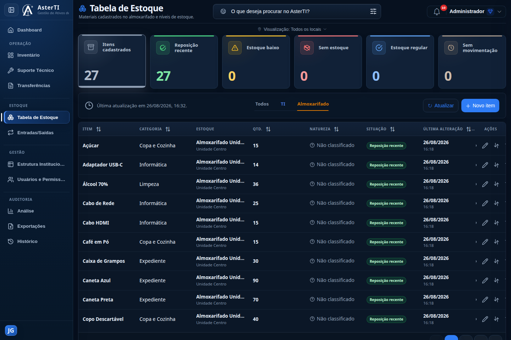

# AsterTI

## Gestão de ativos de tecnologia da informação

O **AsterTI** é uma aplicação web voltada ao controle operacional de ativos de
TI. O sistema reúne inventário, chamados técnicos, movimentações, controle de
material de consumo pelo Aster Estoque, estrutura organizacional, usuários,
permissões e auditoria em uma experiência única.

Este repositório é uma apresentação pública de portfólio. Ele contém somente
documentação e capturas produzidas com dados fictícios. **O código-fonte do
AsterTI é privado, proprietário e não integra este repositório.**

## Visão rápida

| Indicador | Escala confirmada |
|---|---|
| Áreas funcionais documentadas | 11 |
| Perfis de acesso | 5 |
| Materiais visuais revisados | 7 capturas e 1 demonstração animada |
| Camadas de testes automatizados | Backend e fluxos de interface |
| Rastreabilidade | Histórico de ações e auditoria por contexto |

## Demonstração

O percurso apresenta Dashboard, Inventário, Suporte Técnico, Movimentações,
Análise Operacional e Aster Estoque em um ambiente isolado com dados
fictícios.

## Problema que o sistema resolve

Controles de equipamentos distribuídos entre planilhas, documentos e registros
manuais dificultam localizar um ativo, identificar seu responsável, acompanhar
uma manutenção e reconstruir seu histórico. O AsterTI centraliza essas
informações e aplica regras operacionais ao ciclo de vida do ativo, oferecendo
rastreabilidade e visibilidade gerencial.

## Principais módulos

| Módulo | Finalidade |
|---|---|
| Dashboard | Indicadores consolidados e visão operacional do ambiente. |
| Inventário | Cadastro e consulta de equipamentos, situação, localização e responsabilidade. |
| Suporte Técnico | Registro e acompanhamento de chamados, prioridades, responsáveis e conclusão. |
| Movimentações | Empréstimos, transferências, encaminhamentos, devoluções e posse. |
| Aster Estoque | Controle de material de consumo por almoxarifado, com remessas de envio e recebimento entre unidades. |
| Estrutura Institucional | Organização de locais, setores, pessoas e catálogos técnicos. |
| Reserva e Armazenamento | Controle de ativos guardados e destinos de devolução. |
| Usuários e Permissões | Administração de contas, perfis e escopos de acesso. |
| Histórico de Ações | Auditoria de eventos relevantes em linguagem operacional. |
| Análise Operacional | Indicadores, tendências, rankings e alertas de acompanhamento. |
| Exportações | Geração controlada de documentos e dados autorizados. |

Detalhes em [Funcionalidades](docs/funcionalidades.md).

## Tecnologias em alto nível

- aplicação web com backend em Python e Flask;
- interface construída com tecnologias web nativas;
- persistência relacional, com SQLite para desenvolvimento e PostgreSQL
  aprovado para uso em produção;
- testes automatizados de backend e de fluxos de interface, incluindo
  validação cruzada entre os dois bancos suportados;
- autenticação, autorização por perfil e trilha de auditoria.

Esta apresentação deliberadamente não descreve estruturas internas, rotas,
esquemas de dados ou detalhes que permitam reproduzir a implementação.

## Perfis e controle de acesso

O AsterTI possui cinco perfis confirmados:

- **Administrador Global:** visão e administração abrangentes;
- **Supervisor Local:** operação limitada ao seu contexto organizacional;
- **Suporte Técnico:** atuação em equipamentos e chamados autorizados;
- **Auditor:** consulta em modo de leitura, incluindo histórico autorizado;
- **Almoxarifado:** operação restrita ao Aster Estoque do seu próprio contexto.

As decisões de autorização são aplicadas no servidor. O acesso também considera
escopo organizacional e permissões associadas ao recurso.

## Arquitetura resumida

O produto segue uma arquitetura web modular: a interface apresenta os
workspaces, a camada de aplicação executa regras de negócio e controle de
acesso, e a persistência mantém dados operacionais e registros de auditoria.
Arquivos e documentos associados são tratados como recursos protegidos.

**Usuário** → **Interface web** → **Aplicação Flask** →
**Núcleo modular do ecossistema Aster** → **SQLite ou PostgreSQL**

O núcleo compartilhado do ecossistema Aster já sustenta dois módulos reais e
independentes — o AsterTI e o Aster Estoque, este último opcional por
instalação. SQLite segue como persistência padrão de desenvolvimento;
PostgreSQL está validado e aprovado para uso em produção.

Veja a [visão arquitetural](docs/arquitetura.md) e o
[diagrama conceitual](diagrams/arquitetura.md).

## Status atual

- **Versão pública documentada no projeto privado:** 1.72;
- **data da versão:** 26 de agosto de 2026;
- **situação:** estável, com módulos operacionais consolidados;
- **persistência atual:** SQLite em desenvolvimento; PostgreSQL aprovado para produção;
- **em evolução:** continuidade da análise operacional configurável e expansão
  do Aster Estoque.

Itens ainda não publicados no projeto privado não são apresentados como
funcionalidades desta versão.

## Histórico de versões

- **1.72:** módulo de Remessa (envio e recebimento entre unidades),
  correção de posse em Reserva e consolidação do registro de auditoria;
- **1.71:** correção da geração de documentos formais e reorganização
  dos quatro documentos oficiais;
- **1.70:** linha do tempo consolidada do histórico de cada ativo e
  unificação dos catálogos de defeito técnico;
- **1.35 a 1.66:** Aster Estoque tornou-se módulo real e opcional da
  plataforma, com integração funcional ao Inventário e persistência
  compartilhada com o núcleo comum;
- **1.10 a 1.20:** separação arquitetural do núcleo compartilhado do
  ecossistema Aster e validação de PostgreSQL como persistência
  alternativa;
- **1.01:** preparação do núcleo compartilhado, Central de Análise Operacional,
  melhorias em notificações, formulários, movimentações e atribuição de
  chamados;
- **1.00:** fechamento do plano de estabilização, consolidação dos módulos,
  reforços de auditoria e melhorias de interface;
- **0.94 a 0.99:** evolução incremental de segurança, permissões, ciclo de vida
  dos ativos, cadastros, reserva, histórico e chamados.

Consulte o [changelog público](CHANGELOG.md).

## Roadmap

As frentes registradas no projeto incluem:

- promover o módulo de chamados técnicos a uma capacidade compartilhada
  entre AsterTI e Aster Estoque, hoje exclusiva do primeiro;
- avaliar uma central de análise operacional configurável pelo próprio
  usuário, além dos indicadores fixos atuais;
- retomar a recepção de dados de uma fonte institucional externa,
  preparada tecnicamente mas ainda não ativada;
- reavaliar papéis de acesso mais granulares e a reativação de
  importação de dados em massa.

O roadmap é indicativo e não representa compromisso de entrega. Veja
[Roadmap](docs/roadmap.md).

## Screenshots

Todas as capturas abaixo foram produzidas em ambiente local descartável, com
banco isolado e dados de demonstração.

O Dashboard está destacado no início desta página.

### Inventário

### Suporte Técnico

### Movimentações

### Análise Operacional

### Aster Estoque

Mais informações em [Screenshots](screenshots/README.md).

## Código-fonte privado

Este repositório **não é uma distribuição do software**. Não contém código,
banco de dados, configurações internas, credenciais, arquivos enviados ou
dados operacionais. O acesso público a esta documentação não concede licença
de uso, cópia, modificação, implantação ou redistribuição do código-fonte.

## Autoria

Desenvolvido por **João Gabriel Colares Lima** como projeto autoral de gestão de
ativos e operações de tecnologia da informação.

## Contato

Para contato profissional, utilize os canais públicos do perfil que hospedar
este repositório. Um endereço direto poderá ser adicionado antes da publicação,
mediante validação do autor.

## Licença dos materiais

Os materiais desta apresentação são proprietários. Consulte
[LICENSE.md](LICENSE.md).
