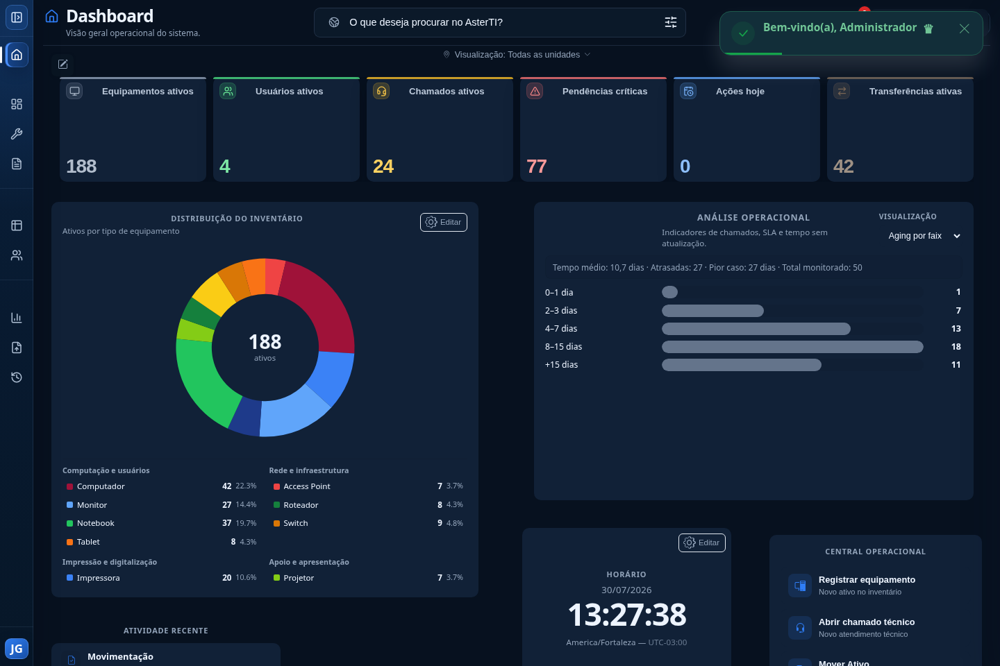
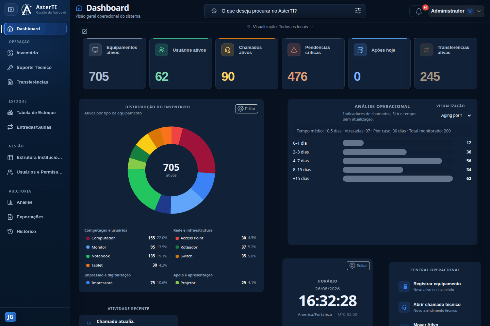
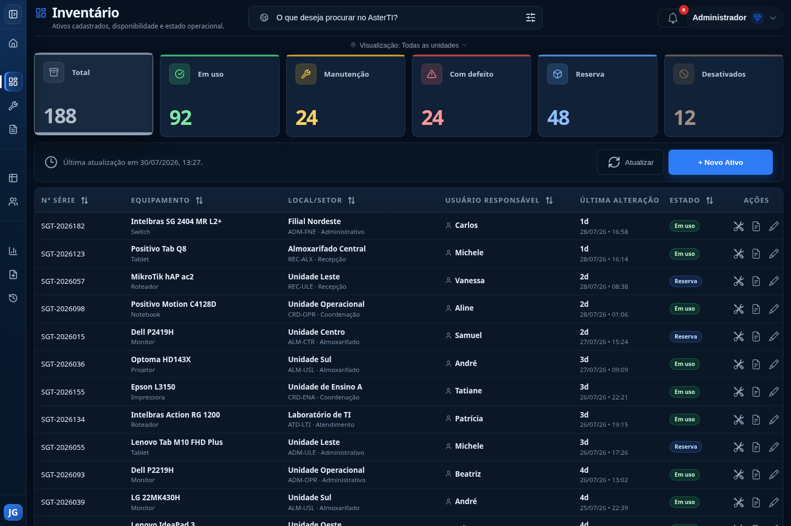
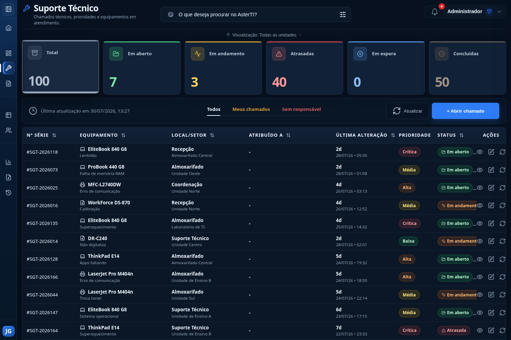
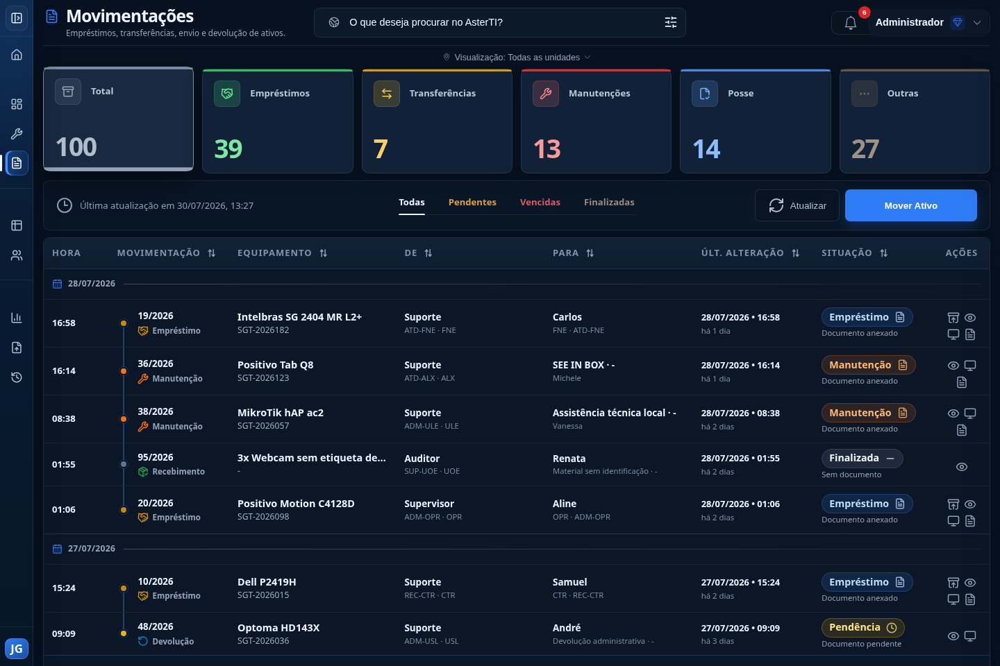
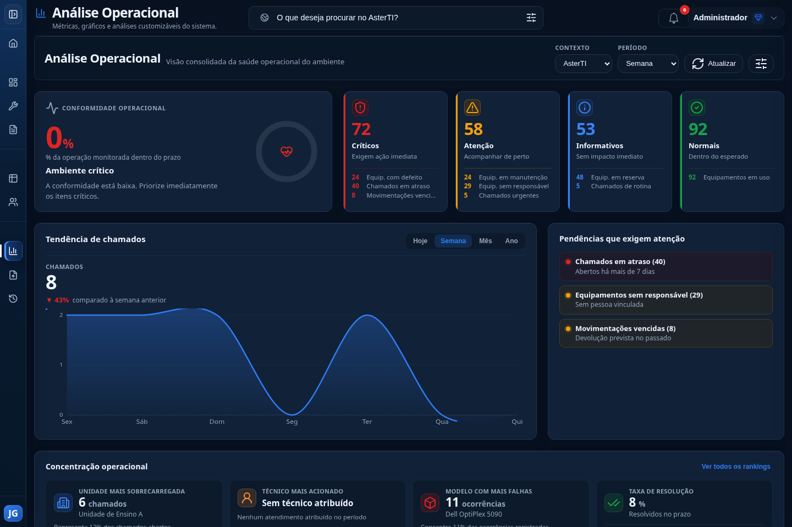

# AsterTI

## Gestão de ativos de tecnologia da informação

O **AsterTI** é uma aplicação web voltada ao controle operacional de ativos de
TI. O sistema reúne inventário, chamados técnicos, movimentações, estrutura
organizacional, usuários, permissões e auditoria em uma experiência única.

Este repositório é uma apresentação pública de portfólio. Ele contém somente
documentação e capturas produzidas com dados fictícios. **O código-fonte do
AsterTI é privado, proprietário e não integra este repositório.**

## Visão rápida

| Indicador | Escala confirmada |
|---|---|
| Áreas funcionais documentadas | 10 |
| Perfis de acesso | 4 |
| Materiais visuais revisados | 6 capturas e 1 demonstração animada |
| Camadas de testes automatizados | Backend e fluxos de interface |
| Rastreabilidade | Histórico de ações e auditoria por contexto |

## Demonstração

O percurso apresenta Dashboard, Inventário, Suporte Técnico, Movimentações e
Análise Operacional em um ambiente isolado com dados fictícios.

## Problema que o sistema resolve

Controles de equipamentos distribuídos entre planilhas, documentos e registros
manuais dificultam localizar um ativo, identificar seu responsável, acompanhar
uma manutenção e reconstruir seu histórico. O AsterTI centraliza essas
informações e aplica regras operacionais ao ciclo de vida do ativo, oferecendo
rastreabilidade e visibilidade gerencial.

## Principais módulos

| Módulo | Finalidade |
|---|---|
| Dashboard | Indicadores consolidados e visão operacional do ambiente. |
| Inventário | Cadastro e consulta de equipamentos, situação, localização e responsabilidade. |
| Suporte Técnico | Registro e acompanhamento de chamados, prioridades, responsáveis e conclusão. |
| Movimentações | Empréstimos, transferências, encaminhamentos, devoluções e posse. |
| Estrutura Institucional | Organização de locais, setores, pessoas e catálogos técnicos. |
| Reserva e Armazenamento | Controle de ativos guardados e destinos de devolução. |
| Usuários e Permissões | Administração de contas, perfis e escopos de acesso. |
| Histórico de Ações | Auditoria de eventos relevantes em linguagem operacional. |
| Análise Operacional | Indicadores, tendências, rankings e alertas de acompanhamento. |
| Exportações | Geração controlada de documentos e dados autorizados. |

Detalhes em [Funcionalidades](docs/funcionalidades.md).

## Tecnologias em alto nível

- aplicação web com backend em Python e Flask;
- interface construída com tecnologias web nativas;
- persistência relacional em SQLite na versão atual;
- testes automatizados de backend e de fluxos de interface;
- autenticação, autorização por perfil e trilha de auditoria.

Esta apresentação deliberadamente não descreve estruturas internas, rotas,
esquemas de dados ou detalhes que permitam reproduzir a implementação.

## Perfis e controle de acesso

O AsterTI possui quatro perfis confirmados:

- **Administrador Global:** visão e administração abrangentes;
- **Supervisor Local:** operação limitada ao seu contexto organizacional;
- **Suporte Técnico:** atuação em equipamentos e chamados autorizados;
- **Auditor:** consulta em modo de leitura, incluindo histórico autorizado.

As decisões de autorização são aplicadas no servidor. O acesso também considera
escopo organizacional e permissões associadas ao recurso.

## Arquitetura resumida

O produto segue uma arquitetura web modular: a interface apresenta os
workspaces, a camada de aplicação executa regras de negócio e controle de
acesso, e a persistência mantém dados operacionais e registros de auditoria.
Arquivos e documentos associados são tratados como recursos protegidos.

**Usuário** → **Interface web** → **Aplicação Flask** →
**Núcleo modular do ecossistema Aster** → **SQLite**

O núcleo compartilhado está em separação progressiva. SQLite é a persistência
confirmada da versão atual; PostgreSQL permanece apenas como possibilidade de
roadmap.

Veja a [visão arquitetural](docs/arquitetura.md) e o
[diagrama conceitual](diagrams/arquitetura.md).

## Status atual

- **Versão pública documentada no projeto privado:** 1.01;
- **data da versão:** 29 de julho de 2026;
- **situação:** estável, com módulos operacionais consolidados;
- **persistência atual:** SQLite;
- **em evolução:** separação progressiva do núcleo compartilhado e continuidade
  da análise operacional.

Itens posteriores à versão 1.01 que ainda não foram publicados não são
apresentados como funcionalidades desta versão.

## Histórico de versões

- **1.01:** preparação do núcleo compartilhado, Central de Análise Operacional,
  melhorias em notificações, formulários, movimentações e atribuição de
  chamados;
- **1.00:** fechamento do plano de estabilização, consolidação dos módulos,
  reforços de auditoria e melhorias de interface;
- **0.94 a 0.99:** evolução incremental de segurança, permissões, ciclo de vida
  dos ativos, cadastros, reserva, histórico e chamados.

Consulte o [changelog público](CHANGELOG.md).

## Roadmap

As frentes registradas no projeto incluem:

- continuar a separação do núcleo compartilhado, mediante decisões de
  fronteira ainda pendentes;
- evoluir o desacoplamento de histórico e exportações;
- validar a métrica principal da Análise Operacional;
- reavaliar presets persistentes para a análise;
- estudar compatibilidade com PostgreSQL, ainda sem autorização de
  implementação.

O roadmap é indicativo e não representa compromisso de entrega. Veja
[Roadmap](docs/roadmap.md).

## Screenshots

Todas as capturas abaixo foram produzidas em ambiente local descartável, com
banco isolado e dados de demonstração.

O Dashboard está destacado no início desta página.

### Inventário

### Suporte Técnico

### Movimentações

### Análise Operacional

Mais informações em [Screenshots](screenshots/README.md).

## Código-fonte privado

Este repositório **não é uma distribuição do software**. Não contém código,
banco de dados, configurações internas, credenciais, arquivos enviados ou
dados operacionais. O acesso público a esta documentação não concede licença
de uso, cópia, modificação, implantação ou redistribuição do código-fonte.

## Autoria

Desenvolvido por **João Gabriel Colares Lima** como projeto autoral de gestão de
ativos e operações de tecnologia da informação.

## Contato

Para contato profissional, utilize os canais públicos do perfil que hospedar
este repositório. Um endereço direto poderá ser adicionado antes da publicação,
mediante validação do autor.

## Licença dos materiais

Os materiais desta apresentação são proprietários. Consulte
[LICENSE.md](LICENSE.md).
